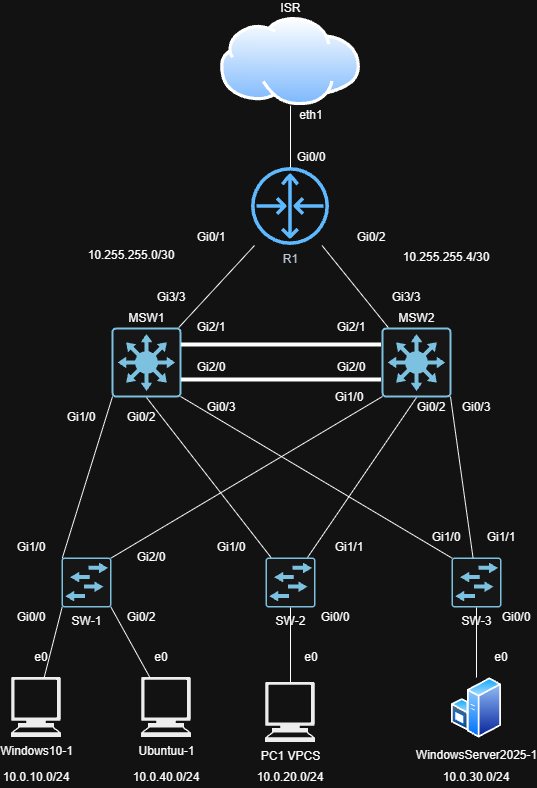
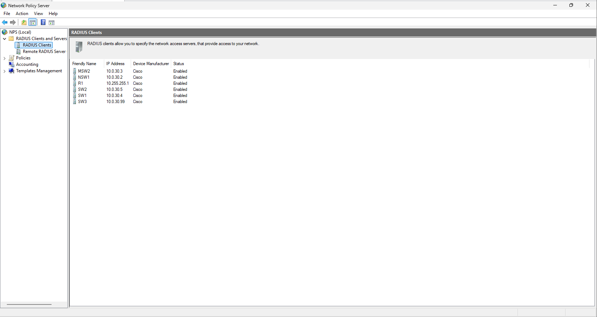
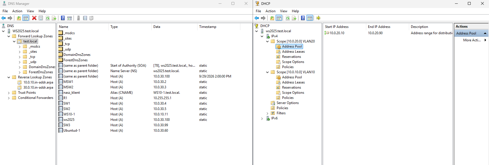
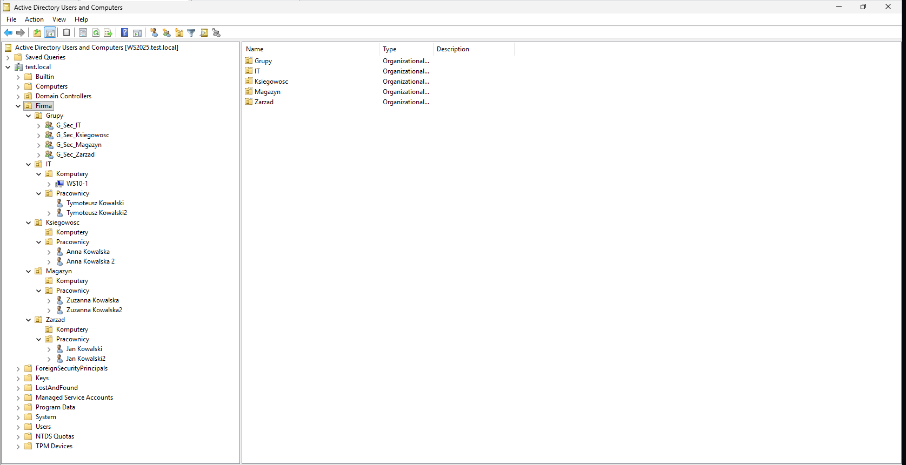
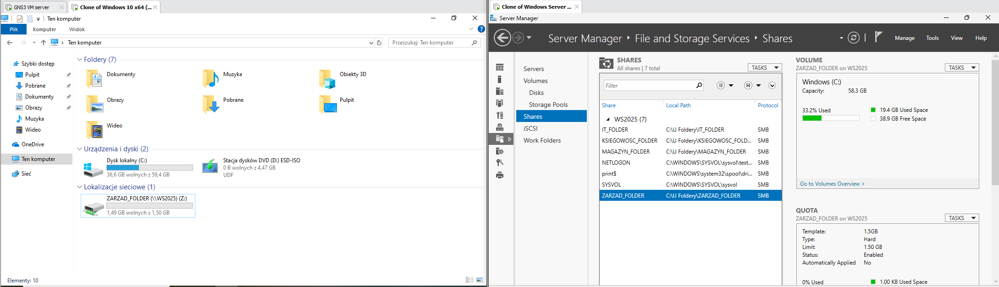
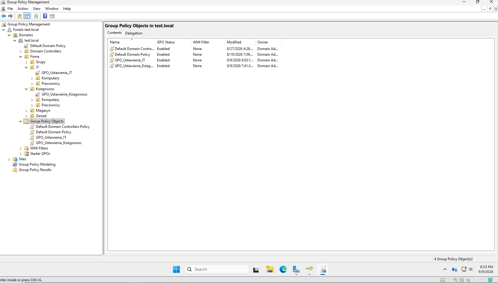
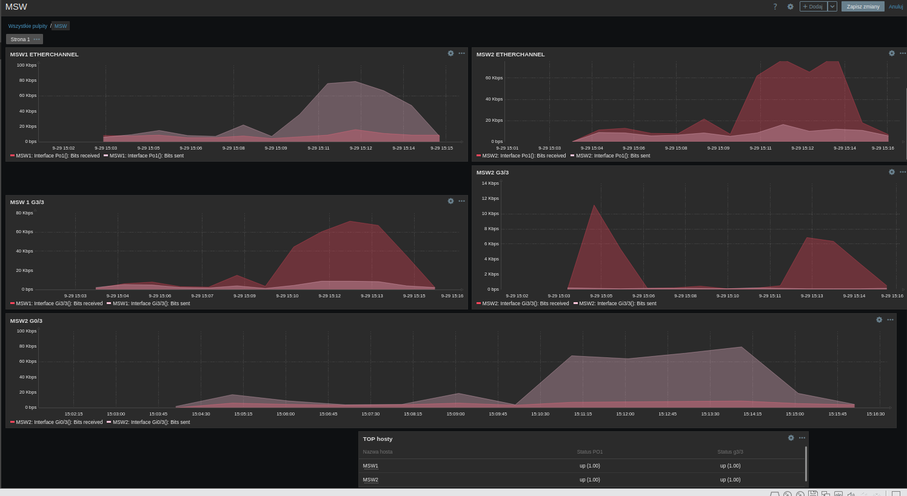
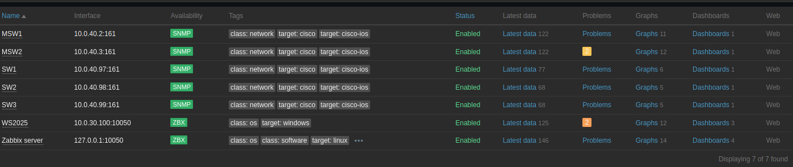

# Projekt Sieci z Integracją Windows Server

## Spis treści
- [Opis projektu](#opis-projektu)
- [Topologia sieci](#topologia-sieci)
- [Architektura Adresacji i VLAN](#architektura-adresacji-i-vlan)
- [Integracja z Windows Server](#integracja-z-windows-server-i-usługi-systemowe)
- [Monitorowanie Infrastruktury](#monitorowanie-infrastruktury-zabbix--linux)
- [Pliki w repozytorium](#pliki-w-repozytorium)

## Opis projektu
Projekt przedstawia konfigurację sieci LAN przedsiębiorstwa z naciskiem na wysoką dostępność (High Availability), redundancję oraz bezpieczeństwo. Środowisko sieciowe zintegrowałem z usługami serwerowymi opartymi na systemie Windows Server.

## Topologia sieci

 
  

### Architektura Adresacji i VLAN

| ID VLAN | Nazwa VLAN  | Podsieć IP   | Opis / Usługi Systemowe                                        |
|---------|-------------|--------------|----------------------------------------------------------------|
| 10      | UZYTKOWNICY | 10.0.10.0/24 | Stacje robocze, ochrona DHCP Snooping                          |
| 20      | GOSCIE      | 10.0.20.0/24 | Izolowany dostęp dla gości, ograniczony ruch sieciowy          |
| 30      | SERWERY     | 10.0.30.0/24 | Windows Server (Active Directory, DHCP, DNS, GPO)              |
| 40      | ZARZADZANIE | 10.0.40.0/24 | Linux (Zabbix), interfejsy zarządzające Cisco                  |

- **Niezawodność w warstwie 2 (STP Load Balancing):** Aby zapobiec pętlom i optymalnie wykorzystać łącza, wdrożyłem **Rapid-PVST+**. Skonfigurowałem MSW1 jako Root Bridge dla VLAN 10 (Klienci) i 30 (Serwery), natomiast MSW2 jest Rootem dla VLAN 20 (Goście).
- **Agregacja łączy (LACP):** Kluczowe połączenia między przełącznikami wielowarstwowymi (MSW1 i MSW2) spiąłem w logiczny kanał (**EtherChannel/LACP**), zwiększając przepustowość i dodając redundancję.
- **Redundancja bramy domyślnej:** Na styku warstwy L2 i L3 wdrożyłem protokół **HSRP**, zapewniając stacjom końcowym niezawodny dostęp do bramy nawet w przypadku awarii jednego z głównych switchy.
- **Routing (OSPF) i wyjście na świat:** Komunikację w rdzeniu oparłem na routingu dynamicznym **OSPF** (z adresacją /30 na łączach P2P do routera). Na routerze brzegowym (R1) uruchomiłem **PAT (NAT Overload)**, dając maszynom dostęp do Internetu.
- **Zabezpieczenia Warstwy Dostępowej (L2 Security):** Wdrożyłem mechanizmy chroniące przed atakami w warstwie drugiej na przełącznikach dostępowych. Skonfigurowałem **DHCP Snooping** oraz **Dynamic ARP Inspection (DAI)** dla kluczowych sieci VLAN (10, 20, 30). Dostęp do portów brzegowych zabezpieczyłem dodatkowo za pomocą **Port Security** z restrykcyjnym limitem adresów MAC (opcja sticky).
- **Scentralizowane uwierzytelnianie (AAA i RADIUS):** Wdrożyłem model AAA na urządzeniach sieciowych, integrując je z serwerem RADIUS działającym w środowisku Windows Server (NPS). Dostęp administracyjny weryfikuję w oparciu o poświadczenia domenowe, a w przypadku niedostępności serwera skonfigurowałem automatyczne przełączanie się urządzeń na lokalną bazę (Fallback).

  
<b>Kliknij, aby zobaczyć konfigurację serwera RADIUS (NPS)</b>

   
  

### Integracja z Windows Server i Usługi Systemowe

- **Usługi Infrastrukturalne:** W VLAN 30 postawiłem działający **Windows Server**, który dostarcza kluczowe usługi **DHCP** i **DNS** dla maszyn w innych segmentach sieci.

  
<b>Kliknij, aby zobaczyć konfigurację DNS i DHCP</b>

   
  

- **Usługi Domenowe (Active Directory AD DS):** Wdrożyłem domenę korporacyjną oraz logiczną strukturę jednostek organizacyjnych (**OU**) odzwierciedlającą podział na działy firmy, wraz z zarządzaniem kontami użytkowników i komputerów.

  
<b>Kliknij, aby zobaczyć strukturę Active Directory</b>

   
  

- **Serwer Plików i Mapowanie Dysków (GPO):** Skonfigurowałem centralny serwer plików z odpowiednimi uprawnieniami dostępu (NTFS) podzielonymi na poszczególne działy. Zautomatyzowałem proces podłączania zasobów, wykorzystując zasady grupy (GPO) do dynamicznego mapowania dysków sieciowych po zalogowaniu użytkownika.

  
<b>Kliknij, aby zobaczyć mapowanie dysków (GPO)</b>

   
  

- **Scentralizowane Zarządzanie i Bezpieczeństwo (GPO):** Skonfigurowałem zasady grupy (**Group Policy Objects**) dla stacji roboczych z systemem Windows 10, w tym zaawansowane zasady audytu systemu (**Advanced Audit Policy**) monitorujące zdarzenia logowania i bezpieczeństwa.

  
<b>Kliknij, aby zobaczyć polityki GPO</b>

   
  

## Monitorowanie Infrastruktury (Zabbix & Linux)

Środowisko rozbudowałem o system klasy NMS (Network Management System) w celu proaktywnego monitorowania stanu urządzeń sieciowych.

- **Serwer Monitoringu:** Wdrożyłem system operacyjny **Linux (Ubuntu)** oraz zainstalowałem i skonfigurowałem serwer **Zabbix**.
- **Integracja SNMP:** Skonfigurowałem protokół SNMP na urządzeniach Cisco (router brzegowy, przełączniki dystrybucyjne i dostępowe) w celu zdalnego zbierania metryk.
- **Wizualizacja i Dashboardy:** Utworzyłem dedykowane pulpity monitorujące w Zabbixie, które obejmują:
  - Obciążenie pasma na kluczowych łączach oraz zagregowanych portach (EtherChannel / Port-Channel).
  - Bieżący stan operacyjny (UP/DOWN) kluczowych interfejsów.

  
<b>Kliknij, aby zobaczyć Dashboardy i statusy w Zabbixie</b>

   
    
  

## Pliki w repozytorium

📂 **Konfiguracje urządzeń sieciowych (Running-config):**
* [Konfiguracja Routera Brzegowego (R1)](Konfiguracje/R1.txt)
* [Konfiguracja Switcha L3 (MSW1)](Konfiguracje/MSW1.txt)
* [Konfiguracja Switcha L3 (MSW2)](Konfiguracje/MSW2.txt)
* [Konfiguracja Switcha Dostępowego (SW1)](Konfiguracje/SW1.txt)
* [Konfiguracja Switcha Dostępowego (SW2)](Konfiguracje/SW2.txt)
* [Konfiguracja Switcha Dostępowego (SW3)](Konfiguracje/SW3.txt)

🖼️ **Zrzuty ekranu i schematy:**
* [Schemat Topologii Sieci](screenshots/TOPOLOGIA_SIECI.drawio.png)
* [Konfiguracja RADIUS (NPS)](screenshots/W2025_RADIUS.png)
* [DNS i DHCP](screenshots/DHCP_DNS.png)
* [Drzewo Active Directory](screenshots/Drzewo_AD.png)
* [Mapowanie dysków (GPO)](screenshots/Mapowanie_GPO.png)
* [Konfiguracja GPO](screenshots/GPO.png)
* [Zabbix - Dashboard](screenshots/Zabbix_dashboard.png)
* [Zabbix - Status SNMP](screenshots/Zabbix_hosts.png)
